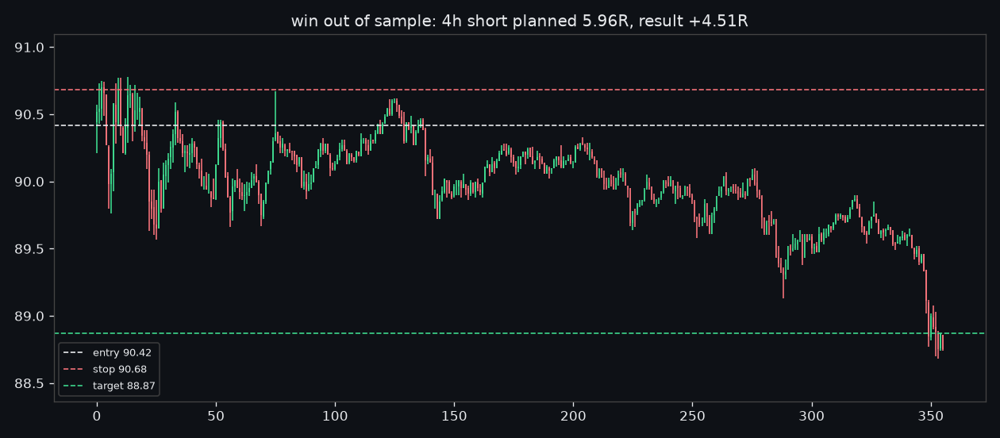
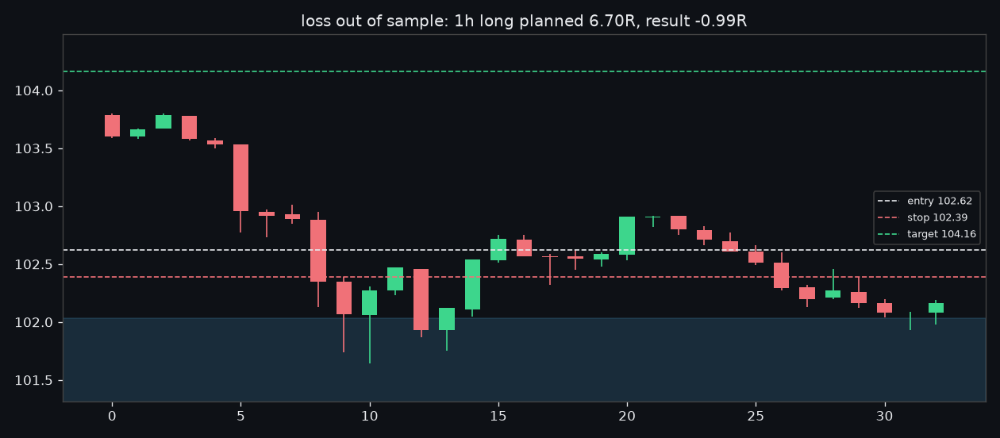

# 1h/4h fair-value-gap backtest

Generated by `python backtest_fvg_mtf.py`. This does not turn the variant on.

- Source: **okx** SOLUSDT 5-minute candles, resampled to 15m, 1h and 4h. Incomplete buckets are dropped.
- Window: 2026-08-21 02:40 UTC → 2026-11-19 02:35 UTC. Fills before 2026-08-21 02:40 UTC are warm-up. The split is the first 60 days in sample and the last 30 out of sample, by fill time.
- Fees: maker 0.0002, taker 0.00055, inside a fixed **5 USDT** risk, same sizing as `backtest.py`. **Slippage and funding are not modelled.**
- Caps on every row, including the baseline: one open position, stop new entries after 3R (15 USDT) realized on that UTC day, at most 6 fills a day, pause after 3 consecutive losses.
- Pre-registered rules, chosen before this run and used if `strategy_variant` is ever set to `fvg_mtf`: **1h and 4h gaps together, 0.05% stop buffer, skip planned reward below 1R.** The other rows are a sensitivity check. Picking the best of them after seeing the holdout is overfitting.
- Entry is the proximal extreme of the last opposite-color 5m candle before the CHoCH (its high for a long, its low for a short). The stop is the other extreme of that same candle, plus either $0.05 or 0.05% of that extreme. A 1h tap has 24 five-minute bars (2 hours) to print the CHoCH; a 4h tap has 48 bars (4 hours). Trading through the far side of the gap cancels the idea. The limit expires after 12 bars.
- The target is the nearer of an unmitigated 1h/4h swing and the near edge of an opposing unmitigated gap, using only levels that exist on the signal close. Average planned R is that distance divided by the stop distance, before fees. Win rate and avg R are after fees.

Planned reward averaged about 6R to 14R, and the win rate stayed under 17% on the full window, so those far targets were not hit often enough to pay for the stops.

The rejection counts below include warm-up fills. The tables count only fills inside the 90-day window. Rejections before the caps, for the min-1R rows: 1h gaps, $0.05 buffer, min 1R: closed 35, kept 35, rejected by min R 4, no target 5, 1h gaps, 0.05% buffer, min 1R: closed 35, kept 35, rejected by min R 4, no target 5, 4h gaps, $0.05 buffer, min 1R: closed 23, kept 23, rejected by min R 0, no target 5, 4h gaps, 0.05% buffer, min 1R: closed 23, kept 23, rejected by min R 0, no target 5, 1h+4h gaps, $0.05 buffer, min 1R: closed 52, kept 52, rejected by min R 8, no target 5, 1h+4h gaps, 0.05% buffer, min 1R: closed 52, kept 52, rejected by min R 7, no target 5.

## Full 90 days

| Variant | Trades | Win rate | Avg R | Total R | Max DD (R) | Avg planned R |
|---|---:|---:|---:|---:|---:|---:|
| 1h gaps, $0.05 buffer, min 1R | 24 | 16.7% | -0.410 | -9.85 | 9.85 | 8.02 |
| 1h gaps, $0.05 buffer, no R filter | 24 | 16.7% | -0.410 | -9.85 | 10.37 | 7.81 |
| 1h gaps, 0.05% buffer, min 1R | 24 | 16.7% | -0.419 | -10.06 | 10.06 | 7.73 |
| 1h gaps, 0.05% buffer, no R filter | 24 | 16.7% | -0.419 | -10.05 | 10.42 | 7.51 |
| 4h gaps, $0.05 buffer, min 1R | 21 | 9.5% | -0.202 | -4.23 | 11.96 | 13.75 |
| 4h gaps, $0.05 buffer, no R filter | 21 | 9.5% | -0.202 | -4.23 | 11.96 | 13.75 |
| 4h gaps, 0.05% buffer, min 1R | 21 | 9.5% | -0.208 | -4.38 | 11.95 | 13.38 |
| 4h gaps, 0.05% buffer, no R filter | 21 | 9.5% | -0.208 | -4.38 | 11.95 | 13.38 |
| 1h+4h gaps, $0.05 buffer, min 1R | 41 | 14.6% | -0.473 | -19.38 | 20.91 | 6.68 |
| 1h+4h gaps, $0.05 buffer, no R filter | 42 | 14.3% | -0.485 | -20.37 | 22.90 | 6.42 |
| 1h+4h gaps, 0.05% buffer, min 1R | 41 | 14.6% | -0.478 | -19.59 | 21.12 | 6.46 |
| 1h+4h gaps, 0.05% buffer, no R filter | 42 | 14.3% | -0.490 | -20.58 | 23.11 | 6.21 |
| 1h/15m baseline | 36 | 27.8% | -0.286 | -10.31 | 18.59 | 2.00 |
| adaptive study (cited) | 34 | 47.1% | +0.108 | +3.69 | 5.45 | — |

## In sample (first 60 days)

| Variant | Trades | Win rate | Avg R | Total R | Max DD (R) | Avg planned R |
|---|---:|---:|---:|---:|---:|---:|
| 1h gaps, $0.05 buffer, min 1R | 18 | 22.2% | -0.215 | -3.87 | 9.38 | 8.38 |
| 1h gaps, $0.05 buffer, no R filter | 19 | 21.1% | -0.256 | -4.86 | 10.37 | 7.99 |
| 1h gaps, 0.05% buffer, min 1R | 18 | 22.2% | -0.227 | -4.08 | 9.43 | 8.03 |
| 1h gaps, 0.05% buffer, no R filter | 19 | 21.1% | -0.267 | -5.07 | 10.42 | 7.66 |
| 4h gaps, $0.05 buffer, min 1R | 15 | 6.7% | -0.383 | -5.74 | 11.96 | 14.33 |
| 4h gaps, $0.05 buffer, no R filter | 15 | 6.7% | -0.383 | -5.74 | 11.96 | 14.33 |
| 4h gaps, 0.05% buffer, min 1R | 15 | 6.7% | -0.392 | -5.88 | 11.95 | 13.70 |
| 4h gaps, 0.05% buffer, no R filter | 15 | 6.7% | -0.392 | -5.88 | 11.95 | 13.70 |
| 1h+4h gaps, $0.05 buffer, min 1R | 30 | 13.3% | -0.531 | -15.93 | 19.44 | 6.96 |
| 1h+4h gaps, $0.05 buffer, no R filter | 32 | 12.5% | -0.560 | -17.91 | 21.43 | 6.59 |
| 1h+4h gaps, 0.05% buffer, min 1R | 30 | 13.3% | -0.538 | -16.14 | 19.49 | 6.67 |
| 1h+4h gaps, 0.05% buffer, no R filter | 32 | 12.5% | -0.566 | -18.13 | 21.48 | 6.31 |
| 1h/15m baseline | 27 | 22.2% | -0.461 | -12.44 | 18.59 | 2.00 |
| adaptive study (cited) | 20 | 45.0% | +0.064 | +1.27 | 5.45 | — |

## Out of sample (last 30 days)

| Variant | Trades | Win rate | Avg R | Total R | Max DD (R) | Avg planned R |
|---|---:|---:|---:|---:|---:|---:|
| 1h gaps, $0.05 buffer, min 1R | 6 | 0.0% | -0.997 | -5.98 | 5.98 | 6.93 |
| 1h gaps, $0.05 buffer, no R filter | 5 | 0.0% | -0.997 | -4.99 | 4.99 | 7.11 |
| 1h gaps, 0.05% buffer, min 1R | 6 | 0.0% | -0.997 | -5.98 | 5.98 | 6.82 |
| 1h gaps, 0.05% buffer, no R filter | 5 | 0.0% | -0.997 | -4.98 | 4.98 | 6.93 |
| 4h gaps, $0.05 buffer, min 1R | 6 | 16.7% | +0.251 | +1.51 | 2.99 | 12.32 |
| 4h gaps, $0.05 buffer, no R filter | 6 | 16.7% | +0.251 | +1.51 | 2.99 | 12.32 |
| 4h gaps, 0.05% buffer, min 1R | 6 | 16.7% | +0.251 | +1.50 | 2.99 | 12.58 |
| 4h gaps, 0.05% buffer, no R filter | 6 | 16.7% | +0.251 | +1.50 | 2.99 | 12.58 |
| 1h+4h gaps, $0.05 buffer, min 1R | 11 | 18.2% | -0.314 | -3.45 | 4.98 | 5.92 |
| 1h+4h gaps, $0.05 buffer, no R filter | 10 | 20.0% | -0.246 | -2.46 | 4.98 | 5.91 |
| 1h+4h gaps, 0.05% buffer, min 1R | 11 | 18.2% | -0.314 | -3.45 | 4.98 | 5.91 |
| 1h+4h gaps, 0.05% buffer, no R filter | 10 | 20.0% | -0.245 | -2.45 | 4.98 | 5.87 |
| 1h/15m baseline | 9 | 44.4% | +0.236 | +2.12 | 3.34 | 2.00 |
| adaptive study (cited) | 14 | 50.0% | +0.173 | +2.42 | 2.34 | — |

## Out-of-sample verdict

the pre-registered variant did not beat the 1h/15m baseline out of sample: expectancy was not higher; total R was not higher; drawdown was more than 20% worse.

The pre-registered row is `1h+4h gaps, 0.05% buffer, min 1R`. The highest out-of-sample expectancy among the twelve sensitivity rows was **4h gaps, $0.05 buffer, min 1R** (6 | 16.7% | +0.251 | +1.51 | 2.99 | 12.32). That ranking uses the holdout, so it is not a setting to ship. The adaptive row is cited from the earlier study on this same OKX cache (34 trades, +0.108R full window, +0.173R on the last 30 days). It was not refit here. A full-window profit that disappears, or shrinks, on the last 30 days is the overfitting warning. Twelve rule combinations on one 30-day path can crown a winner by luck.

## Example trades

The charts are the first out-of-sample win and the first out-of-sample loss under the pre-registered rules, in fill order. They are illustrations, not the best trades.

- win out of sample: 4h short planned 5.96R, result +4.51R. Chart: `fvg_mtf_example_win.png`.
- loss out of sample: 1h long planned 6.70R, result -0.99R. Chart: `fvg_mtf_example_loss.png`.

**Recommendation: Do not install, including in dry run. Leave `strategy_variant: default`.**

`strategy_variant` stays **default**. Entries stay 1h bias and 15m. Dry run stays on. Risk stays 5 USDT. Nothing in this report places an order.
